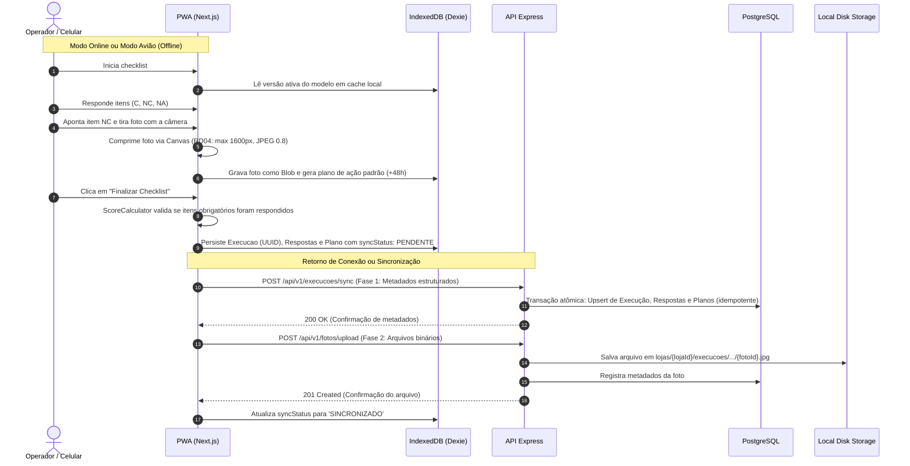

# Guia de Apresentação e Defesa Técnica — App de Checklist Operacional PWA

Este documento serve como roteiro estruturado para a defesa técnica da arquitetura, do código-fonte e das decisões de engenharia adotadas no desenvolvimento do **App de Checklist Operacional PWA**.

---

## 1. Arquitetura Geral e Responsabilidades dos Componentes

O sistema foi arquitetado como uma aplicação **Offline-First**, estruturada em **Monorepo com npm workspaces** (`apps/web` e `apps/api`), garantindo total desacoplamento e responsabilidades bem delineadas:

| Camada / Tecnologia | Responsabilidade Principal |
|---|---|
| **Next.js 14 (App Router) + React 18** | Frontend responsivo e PWA Mobile-First. Interface para Administradores, Gerentes e Operadores, stepper interativo de checklist, captura e compressão de fotos no cliente. |
| **Service Worker + Cache API** | Caching do App Shell e assets estáticos para garantir abertura instantânea sem conectividade. **Importante:** Endpoints de autenticação e mídias nunca são cacheados pelo Service Worker. |
| **Dexie (IndexedDB)** | Persistência cliente transacional para modelos, execuções, respostas, planos de ação e Blobs de fotos em modo offline. |
| **Express + Node.js (TypeScript)** | Backend RESTful, autoridade única de segurança, autenticação JWT, validação rigorosa de schemas (Zod) e isolamento multi-loja. |
| **Prisma ORM** | Modelagem relacional tipada, geração de migrações versionadas, execução de seeds e transações ACID. |
| **PostgreSQL 16** | Banco de dados relacional que atua como fonte da verdade (`source of truth`), restrições únicas (`UNIQUE`), integridade referencial e índices de alto desempenho. |
| **LocalDiskStorage** | Abstração `StorageService` para gravação direta de binários de imagens no disco local (`./data/uploads` no host e `/app/storage/uploads` no container), sem serviços de cloud externos. |
| **Docker Compose** | Orquestração do ambiente conteinerizado (`web`, `api`, `postgres`), com binds mounts persistentes e healthchecks de inicialização. |

---

## 2. Estrutura de Pastas e Fluxo de Execução

### 2.1 Estrutura do Repositório
```text
hering/
├── apps/
│   ├── api/                     # Backend Express, Prisma, StorageService, OpenAPI
│   │   ├── prisma/
│   │   │   ├── migrations/      # Migrações SQL versionadas
│   │   │   ├── schema.prisma    # Modelagem relacional completa
│   │   │   └── seed.ts          # Seed reproduzível (lojas, usuários, modelos)
│   │   ├── src/
│   │   │   ├── config/          # Variáveis de ambiente
│   │   │   ├── errors/          # Classes de erro customizadas (400, 401, 403, 409)
│   │   │   ├── middlewares/     # JWT Auth, RBAC e validação de escopo de loja
│   │   │   ├── routes/          # Rotas REST da API v1
│   │   │   ├── services/        # Regras de negócio (Score, Storage, Sync, Planos)
│   │   │   ├── swagger.ts       # Especificação OpenAPI 3.0 (/api/docs)
│   │   │   ├── app.ts           # Configuração do Express
│   │   │   └── index.ts         # Inicialização do servidor
│   │   └── Dockerfile
│   └── web/                     # Frontend Next.js / PWA
│       ├── public/
│       │   ├── icons/           # Ícones PWA (192x192 e 512x512)
│       │   ├── manifest.json    # Web App Manifest instalável
│       │   └── sw.js            # Service Worker offline shell
│       ├── src/
│       │   ├── app/             # Rotas App Router (login, dashboard, execução, histórico)
│       │   ├── components/      # Navbar, SyncStatusBadge, PhotoCapture, ActionPlanModal
│       │   └── lib/             # Dexie DB, ImageCompression, SyncEngine, ScoreCalculator
│       └── Dockerfile
├── data/
│   └── uploads/                 # Diretório persistente de fotos no disco (ignorado no Git)
├── docs/
│   └── GUIA_APRESENTACAO_TECNICA.md
├── docker-compose.yml           # Orquestração local completa
├── AGENTS.md                    # Convenções para agentes e desenvolvedores
├── AI_LOG.md                    # Registro obrigatório de uso de IA
├── README.md                    # Documentação geral do projeto
└── package.json                 # Monorepo npm workspaces
```

### 2.2 Fluxo de Uma Execução


---

## 3. Autenticação, Autorização por Cargo e Isolamento por Loja

1. **Tokens JWT com Carga Útil Estrita:** O payload contém `{ id, nome, email, cargo, lojaId }`.
2. **Backend como Autoridade de Segurança (Defesa em Profundidade):**
   - Ocultar botões no frontend é apenas UX. Cada rota da API executa os middlewares `authenticateToken`, `requireRole` e `validateStoreAccess`.
3. **Escopo por Cargo:**
   - **Administrador:** Não possui vínculo fixo de loja (`loja_id: null`). Possui autorização global para listar métricas de todas as lojas, criar lojas, cadastrar usuários e gerenciar modelos/versões.
   - **Gerente:** Possui `loja_id` obrigatório. Só pode visualizar checklists da sua própria loja, consultar fotos da sua loja e gerenciar/concluir planos de ação da sua loja.
   - **Operador:** Possui `loja_id` obrigatório. Só pode executar checklists autorizados para seu cargo e vinculados à sua loja.
4. **Isolamento de Loja na Prática:**
   - Se um Gerente ou Operador da Loja Blumenau (`LJ-001`) tentar consultar ou enviar dados para a Loja Paulista (`LJ-002`), a API intercepta a requisição e retorna imediatamente **`403 Forbidden`**.

---

## 4. Modelo de Dados, Relações e Versionamento Imutável

### 4.1 Entidades Principais
- `lojas`: código único, nome, cidade, UF, ativo.
- `cargos`: 'Administrador', 'Gerente', 'Operador'.
- `usuarios`: e-mail único, hash bcrypt, cargo, loja (opcional para Admin).
- `modelos_checklist`: nome, descrição, ativo.
- `versoes_modelo_checklist`: modelo_id, versão incremental (1, 2, ...), cargo permitido, flag publicado.
- `itens_modelo_checklist`: versão_modelo_id, ordem, descrição, obrigatório, exige_foto_em_nc, peso.
- `execucoes`: UUID cliente, loja_id, usuario_id, status ('RASCUNHO'/'FINALIZADA'), pontuação, snapshots.
- `respostas`: UUID cliente, execução_id, item_modelo_id, snapshots imutáveis, valor ('C'/'NC'/'NA').
- `planos_acao`: UUID cliente, resposta_id (restrição `UNIQUE`), loja_id, responsável, prazo (+48h padrão), status ('ABERTO'/'EM_ANDAMENTO'/'CONCLUIDO'), campo `revisao`.
- `fotos`: UUID cliente, vínculo com resposta ou plano, chave relativa no disco, MIME type, tamanho em bytes.

---

## 5. Cálculo da Pontuação, Planos e Evidências

### Regra Matemática RF07 e RD03
$$\text{Pontuação (\%)} = \left( \frac{\sum \text{pesos dos itens com resposta } C}{\sum \text{pesos dos itens com resposta } C \text{ ou } NC} \right) \times 100$$

- **Itens Não se Aplica (NA):** Não entram no numerador e não entram no denominador.
- **Denominador Zero (Sem aplicáveis):** Retorna `null`. A interface exibe `"N/A"`, evitando conformidade artificial de 100%.
- **Itens Obrigatórios:** Se houver qualquer item obrigatório sem resposta, o encerramento do checklist é bloqueado no frontend e rejeitado pela API com `400 Bad Request`.
- **Geração Automática de Plano de Ação:** Toda resposta `NC` gera automaticamente um plano de ação associado com prazo padrão de 48 horas e responsável padrão (Gerente da loja).
- **Conclusão com Evidência:** Para alterar o status do plano para `CONCLUIDO`, a API exige que ao menos uma foto de evidência corretiva esteja vinculada ao plano.

---

## 6. Sincronização Idempotente, UUIDs e Resolução de Conflitos

1. **Geração Client-Side de UUIDs:** Antes de qualquer tentativa de envio, os UUIDs da execução, respostas, planos e fotos são gerados no dispositivo móvel.
2. **Idempotência no Servidor:**
   - O endpoint `/api/v1/execucoes/sync` executa transações de `upsert`.
   - Se uma execução já existir no banco, o reenvio não cria uma nova linha.
   - A constraint única em `planos_acao.resposta_id` garante matematicamente que jamais existirão dois planos para a mesma resposta `NC`.
3. **Resolução de Conflito em Planos de Ação (409 Conflict):**
   - Cada plano possui um contador inteiro `revisao` (inicia em 1).
   - O cliente envia `revisaoEsperada`.
   - Se a revisão no banco divergir da enviada pelo cliente, a API responde `409 Conflict`, devolvendo o estado atual do servidor e impedindo sobrescrita cega.

---

## 7. Armazenamento Local de Fotos e Segurança de Mídia

- **Proibição de Blobs no PostgreSQL:** O banco de dados nunca armazena binários de fotos, apenas metadados (caminho relativo, MIME, tamanho).
- **Caminho Estruturado:**
  - Respostas: `lojas/{lojaId}/execucoes/{execucaoId}/respostas/{respostaId}/{fotoId}.jpg`
  - Evidências: `lojas/{lojaId}/planos/{planoId}/evidencias/{fotoId}.jpg`
- **Mitigação Anti-Path Traversal:** O método `getAbsolutePath` no `LocalDiskStorage` resolve o caminho absoluto e valida com `startsWith(baseDir + path.sep)`, bloqueando qualquer tentativa de escape de diretório (`../`).
- **Endpoint Autenticado para Download:** Nenhuma foto fica em diretório estático aberto. O download em `GET /api/v1/fotos/:id` valida no banco se o usuário solicitante pertence à mesma loja da execução/plano.

---

## 8. Índices Criados no Banco de Dados

| Tabela | Índice | Justificativa e Consulta Otimizada |
|---|---|---|
| `lojas` | `lojas_codigo_key (UNIQUE)` | Otimiza busca rápida de lojas por código (`LJ-001`) e assegura unicidade. |
| `cargos` | `cargos_nome_key (UNIQUE)` | Busca e validação imediata do cargo nas checagens de autorização. |
| `usuarios` | `usuarios_email_key (UNIQUE)` | Otimiza a consulta principal de autenticação/login por e-mail (`WHERE email = ?`). |
| `versoes_modelo_checklist` | `(modelo_id, versao) UNIQUE` | Garante a integridade do versionamento incremental e previne versões duplicadas. |
| `execucoes` | `(loja_id, finalizada_em)` | Acelera a consulta mais frequente do sistema: listagem do histórico de auditorias de uma loja ordenado cronologicamente por conclusão. |
| `execucoes` | `(usuario_id, iniciada_em)` | Otimiza consultas do operador para ver seus checklists em andamento. |
| `respostas` | `(execucao_id)` | Otimiza o carregamento de todas as respostas e itens ao abrir os detalhes de uma execução. |
| `planos_acao` | `(resposta_id) UNIQUE` | Garante unicidade estrita (1 plano por NC) e acelera o vínculo entre resposta e plano. |
| `planos_acao` | `(loja_id, status, prazo)` | Otimiza os painéis gerenciais e consultas de planos pendentes e atrasados da loja. |
| `fotos` | `(resposta_id)` / `(plano_acao_id)` | Acelera a recuperação das fotos vinculadas a uma resposta ou evidência de plano. |

---

## 9. Testes Automatizados e Comandos

Todos os requisitos críticos estão cobertos por testes unitários e de integração executados com **Vitest**:

```bash
# Executar todos os testes do monorepo
npm test

# Executar testes da API
npm run test:api

# Executar testes do Frontend
npm run test:web

# Checagem estrita de tipos TypeScript
npm run typecheck
```

### Resultados dos Testes Verificados
- `ScoreCalculator.test.ts`: 7 testes unitários (cálculo C, NC, NA, pesos, 0 no denominador, pendências).
- `LocalDiskStorage.test.ts`: 3 testes unitários (salvar, ler, idempotência, mitigação anti-path traversal).
- `integration.test.ts`: 15 testes de integração ponta a ponta:
  - Login e autenticação JWT;
  - Bloqueio de credenciais inválidas (401);
  - Bloqueio de envio entre lojas distintas (403);
  - Bloqueio de finalização com itens obrigatórios pendentes (400);
  - Exigência de foto para item NC (400);
  - Sincronização completa e criação de plano de ação;
  - **Idempotência estrita ao reenviar a mesma execução sem duplicar dados**;
  - **Detecção de conflito de concorrência com resposta 409 Conflict**;
  - Exigência de foto de evidência para concluir plano de ação;
  - Bloqueio de alteração de plano por gerente de outra loja (403);
  - Upload e download autenticado de foto no disco local;
  - Bloqueio de download de foto por usuário de outra loja (403);
  - Métricas e ranking do painel gerencial.

---

## 10. Diferenciais Implementados e Limitações

### Diferenciais Concluídos
- **RD01 — Versionamento de Modelos:** Integrado na arquitetura base com entidades separadas `modelos_checklist`, `versoes_modelo_checklist` e snapshots históricos imutáveis.
- **RD03 — Peso por Item:** Pesos ponderados totalmente implementados, com testes cobrindo conformidade ponderada.
- **RD02 — Painel Gerencial:** Ranking de lojas por média de pontuação, total de execuções e contadores de planos abertos e atrasados.
- **RD04 — Compressão de Fotos no Cliente:** Redução automática via HTML5 Canvas (resolução máx. 1600px, qualidade JPEG 0.8) antes da gravação no IndexedDB.
- **RD06 — Exportação PDF:** Suporte a impressão limpa de relatório de execução via media print formatado.

### Diferenciais Não Implementados
- **RD05 — Notificações de Prazo:** Não implementado, pois Web Push Notifications em segundo plano quando o app está fechado requer infraestrutura externa de VAPID keys e push servers proprietários, cuja simulação superficial comprometeria a robustez do sistema.

---

## 11. Respostas Diretas às Três Perguntas Técnicas do Desafio

### Pergunta 1: Por que copiar `item_descricao` e `modelo_versao` para a execução/respostas em vez de depender apenas do modelo atual?
> **Resposta:**
> Em auditorias operacionais e inspeções de conformidade, um checklist finalizado possui valor de auditoria legal e operacional imutável. Se o administrador da rede alterar a descrição de um item (ex: de *"Limpar piso com desinfetante X"* para *"Limpar piso com desinfetante Y"*), ou alterar o peso ou a obrigatoriedade do item, uma auditoria realizada meses antes não pode ter seu significado histórico distorcido.
> Gravar snapshots (`item_descricao_snapshot`, `modelo_versao_snapshot`, `item_peso_snapshot`) garante que o histórico de auditoria represente com fidelidade exata as condições no momento da execução, desacoplando o passado das alterações futuras de cadastro.

### Pergunta 2: Quais índices foram criados e quais consultas justificam cada um?
> **Resposta:**
> Foram criados índices estratégicos para as consultas de maior volume:
> 1. `execucoes(loja_id, finalizada_em)`: Atende a consulta principal do histórico da loja (`SELECT * FROM execucoes WHERE loja_id = ? ORDER BY finalizada_em DESC`). Sem este índice composto, o banco precisaria fazer scan completo e ordenação em memória.
> 2. `planos_acao(loja_id, status, prazo)`: Atende a tela de planos de ação e os cálculos do dashboard para identificar planos atrasados (`status != 'CONCLUIDO' AND prazo < NOW()`).
> 3. `respostas(execucao_id)`: Atende o carregamento detalhado de todas as respostas ao abrir uma execução no app.
> 4. `usuarios(email)` e `lojas(codigo)`: Índices únicos para autenticação rápida e integridade cadastral.
> 5. `planos_acao(resposta_id)`: Índice único que impede duplicações em reenvios de sincronização.

### Pergunta 3: Como a chave da foto é construída e como a API impede que alguém leia fotos de outra loja?
> **Resposta:**
> A chave é padronizada hierarquicamente:
> `lojas/{lojaId}/execucoes/{execucaoId}/respostas/{respostaId}/{fotoId}.jpg`
> ou para evidências de planos: `lojas/{lojaId}/planos/{planoId}/evidencias/{fotoId}.jpg`.
>
> A proteção ocorre em duas etapas:
> 1. As fotos **não são servidas por pastas estáticas públicas**. Todo acesso passa pela rota autenticada `GET /api/v1/fotos/:id`.
> 2. Ao receber a requisição, o middleware extrai o usuário do JWT. A API busca o registro da foto no PostgreSQL e obtém o `loja_id` da execução ou plano associado. Se o usuário for um Gerente ou Operador e seu `lojaId` divergir da loja do registro, a API retorna **`403 Forbidden`** e o arquivo binário sequer é aberto em disco. Além disso, o `LocalDiskStorage` valida se o caminho resultante não sofreu *Path Traversal* (`../`).

---

## 12. Roteiro de Demonstração de 15 Minutos

1. **Abertura e Login (1 min):**
   - Abrir o app em `http://localhost:3000`.
   - Clicar no atalho de demonstração **"Operador Blumenau"** e logar.
2. **Download de Modelos para Cache (1 min):**
   - Mostrar os checklists disponíveis ("Checklist de Abertura de Loja").
   - Explicar que o cache de referência do Dexie foi preenchido.
3. **Simulação do Cenário Offline / Modo Avião (4 min):**
   - Abrir o DevTools (F12) -> aba Network -> selecionar **Offline** (ou desconectar a rede).
   - O indicador no topo do app muda imediatamente para **Offline** (laranja).
   - Clicar em "Iniciar" no Checklist de Abertura.
   - Responder itens como Conforme (`C`).
   - Apontar o item 2 como Não Conforme (`NC`).
   - O app imediatamente exige a foto e exibe o campo para o plano de ação.
   - Anexar uma foto (feita pela câmera ou galeria).
   - Demonstrar o cálculo da pontuação em tempo real com pesos.
   - Clicar em **Finalizar Checklist**.
   - O app salva localmente e exibe o badge **"1 pendente(s)"**.
4. **Retorno da Conexão e Sincronização Idempotente (3 min):**
   - No DevTools, alternar de volta para **Online**.
   - O `SyncEngine` detecta automaticamente o retorno de conexão via evento `online`.
   - O badge muda para **"Sincronizando..."** e depois **"Sincronizado"** (verde).
   - Mostrar no terminal da API que primeiro foram persistidos os metadados e em seguida o upload binário da foto.
5. **Comprovação de Ausência de Duplicatas (2 min):**
   - Forçar um reenvio da sincronização ou recarregar a tela.
   - Demonstrar no PostgreSQL que a execução e o plano de ação possuem exatamente os mesmos IDs e não foram duplicados.
6. **Visão do Gerente e Conclusão de Plano de Ação (3 min):**
   - Desconectar e logar como **"Gerente Blumenau"**.
   - Ir na aba "Planos de Ação" e abrir o plano gerado na Não Conformidade anterior.
   - Demonstrar que tentar concluir sem foto de evidência é bloqueado.
   - Anexar a foto de evidência corretiva e alterar status para **Concluído**.
7. **Visão do Administrador e Painel Gerencial (1 min):**
   - Logar como **"Administrador"**.
   - Visualizar o Ranking de Lojas por Conformidade e os indicadores de planos.

---

## 13. Trade-offs de Arquitetura e Decisões Técnicas

- **Armazenamento em Disco Local vs S3/MinIO:**
  - *Decisão:* Implementação com `LocalDiskStorage` atendendo estritamente ao requisito do desafio.
  - *Trade-off:* Adequado para ambiente mononodal ou demonstração conteinerizada. Em um ambiente de cluster com múltiplas instâncias da API (Kubernetes), a interface `StorageService` permite migrar para um S3 compatível bastando implementar uma nova classe (ex: `S3StorageService`), mantendo o restante da aplicação 100% inalterado.
- **IndexedDB com Dexie vs LocalStorage:**
  - *Decisão:* Dexie com IndexedDB.
  - *Trade-off:* `localStorage` possui limite de ~5MB e não armazena Blobs de imagens. O Dexie oferece suporte a transações assíncronas, índices e armazenamento binário nativo de fotos de forma durável.

